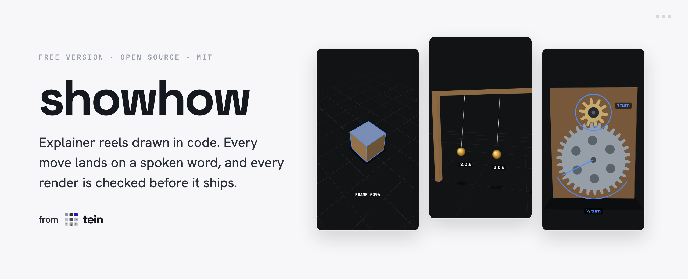
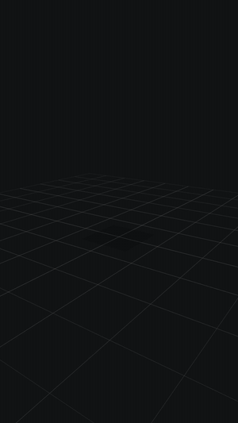
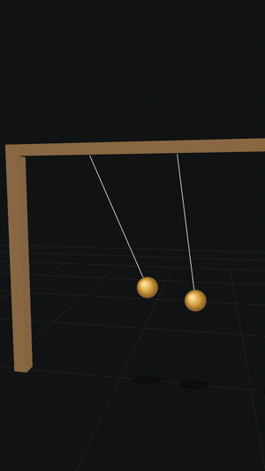
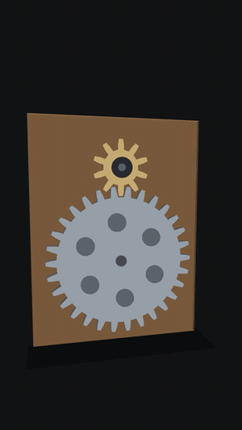
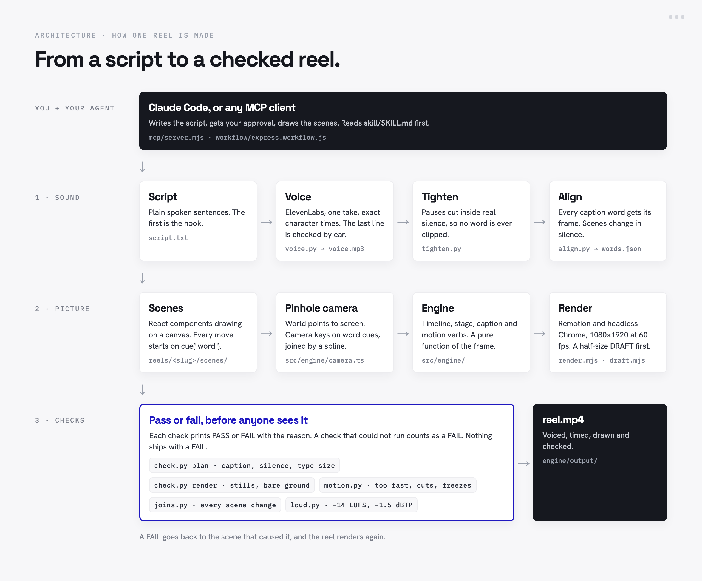

<p align="center"></p>

# showhow

**Explainer reels drawn in code.** You write the script. An agent draws the scenes. Showhow voices it, times every move to
a spoken word, renders it at 1080×1920 and 60 fps, and checks it before anyone sees it. No presenter, no stock footage,
no cuts.

Free and open source, from [tein](https://tein.ai): one cheap API, MCP and workflows for every AI model provider.

<p><a href="https://tein.ai/waitlist"></a></p>

## Watch

Two full reels, with voice and music, made with the same engine and checks. Click one to watch it with sound.

<p align="center">
<a href="https://sirioberati.github.io/showhow/#airplanes"></a>
<a href="https://sirioberati.github.io/showhow/#world"></a>
</p>

- **[How a wing really makes lift ▶](https://sirioberati.github.io/showhow/#airplanes)** · 65 s. The myth, the Cambridge smoke test, pressure, speed and flaps.
- **[What if the Earth were flat? ▶](https://sirioberati.github.io/showhow/#world)** · 58 s. On a disc of rock, gravity pulls toward the pole.

## The demos

Three reels ship in this repo, voiced and timed, so each one renders with no key. Every one passes every check below.
Click one to watch it with sound.

<p align="center">
<a href="https://sirioberati.github.io/showhow/#demo"></a>
<a href="https://sirioberati.github.io/showhow/#pendulum"></a>
<a href="https://sirioberati.github.io/showhow/#gears"></a>
</p>

- **[demo ▶](https://sirioberati.github.io/showhow/#demo)** · 8 s. A block falls under real gravity, lands on its word, and the camera circles it.
- **[pendulum ▶](https://sirioberati.github.io/showhow/#pendulum)** · 12 s. Big and small swings keep the same time; a string a quarter as long swings twice as fast.
- **[gears ▶](https://sirioberati.github.io/showhow/#gears)** · 14 s. 10 teeth turn 30 a third of a turn, the other way, with three times the force.

The demo voices are Matilda, an ElevenLabs stock voice.

## How it works

<p align="center"></p>

1. **Sound.** The script is voiced by ElevenLabs in one take, with the time of every character. Pauses are shortened
   inside real silence, so no word is clipped. Then every caption word gets its frame in `words.json`.
2. **Picture.** Each scene is a React component drawing on a canvas through a small pinhole camera. Every move starts on
   `cue("word")`, and every value is a pure function of the frame, so any frame renders on its own.
3. **Checks.** The render is measured: too fast to follow, a cut, a freeze, a bad scene change, the wrong loudness. Each
   check prints PASS or FAIL with the reason. A FAIL goes back to its scene.

## Quick start

Needs Node 22.12+, Python 3 with `numpy` and `Pillow`, and `ffmpeg`.

```bash
npm install
pip3 install numpy Pillow
cd engine
node render.mjs pendulum
```

The render lands in `engine/output/<date>/`. For a quick look first, `node draft.mjs pendulum` makes a half-size draft
stamped DRAFT, and `node render.mjs pendulum --stills 2.6,9.6 --half` saves single frames.

## Make your own reel

You need an [ElevenLabs](https://elevenlabs.io) key for the voice, and
[whisper.cpp](https://github.com/ggerganov/whisper.cpp) (`brew install whisper-cpp`) with `ggml-small.en.bin` in
`models/`, which confirms the last line of each take was really spoken.

```bash
cp .env.example .env.local     # then put your ElevenLabs key in it
```

The key stays on your machine. It is only sent to ElevenLabs.

### From Claude Code

```bash
claude mcp add showhow -- node "$(pwd)/mcp/server.mjs"
```

Then ask: *"make a showhow reel about why ice floats"*. The agent reads `skill/SKILL.md`, writes the script, waits for
your approval, and works through the tools:

| Tool | What it does |
|---|---|
| `new_reel` | makes the folder: script, caption, config and a stub per scene |
| `voice` | voices the script with ElevenLabs and puts every pause in real silence |
| `voice_free` | the same with Kokoro, an open voice model that runs locally with no key |
| `align` | times every caption word and writes `words.json` |
| `check_plan` | checks the caption and timing before anything is drawn |
| `typecheck` | type-checks the engine and every scene |
| `stills` | renders single frames at the seconds you pick |
| `draft` | renders the half-size DRAFT to watch before the final |
| `render` | renders the final reel and levels its sound |
| `check_render` | runs every check on the final render |
| `list_reels` | lists the reels and how far each has got |

For bigger reels, copy `workflow/express.workflow.js` into `.claude/workflows/`. It runs two builders in parallel, makes
the DRAFT, then reviews the whole reel and renders it.

### By hand

```bash
cd engine
python3 scripts/voice.py my-reel        # ElevenLabs, voice id in reels/my-reel/reel.json
python3 scripts/tighten.py my-reel
python3 scripts/align.py my-reel
python3 scripts/check.py plan my-reel
node draft.mjs my-reel
node render.mjs my-reel
```

## The checks

| Check | Fails when |
|---|---|
| `check.py plan` | a caption block runs over 8 words, or a scene change falls outside silence |
| `check.py render` | nothing moves for over 1.2 s, or the ground shows bare at a scene change |
| `motion.py` | a move is too fast to follow, a cut or snap, a freeze then a jump, or a scene under 2 s |
| `joins.py` | one frame swaps the picture at a scene change (it also writes a sheet of every change) |
| `loud.py` | the sound is off −14 LUFS, or peaks above −1.5 dBTP (`--fix` levels it) |

A check that could not run counts as a FAIL.

## What's inside

```
engine/
  src/engine/        the engine: timeline, stage, caption, motion verbs, pinhole camera
  scripts/           voice, tighten, align, and the five checks
  reels/             demo, pendulum, gears: script, caption, voice, timing, scenes
  render.mjs         renders stills, a time range, or the whole reel
  draft.mjs          the half-size DRAFT
mcp/server.mjs       the local MCP server (stdio, no dependencies)
workflow/            the Express workflow for Claude Code
skill/SKILL.md       the guide an agent reads first
```

Built on [Remotion](https://www.remotion.dev), React and canvas 2D. Voice by [ElevenLabs](https://elevenlabs.io).

## Join tein

tein is one API for AI image, video, audio and language models, priced below market. One key and one bill across the
model providers: Seedance, Kling, Nano Banana, GPT Image, Claude, Wan, Qwen and more.

- **A cheap API.** Every model through one endpoint, for less than going direct. [Pricing](https://tein.ai/pricing)
- **MCP.** Plug tein into Claude Code or any MCP client and call every model from your agent. [MCPs](https://tein.ai/mcps)
- **Workflows.** Ready-made pipelines that chain models into one result. [Workflows](https://tein.ai/workflows)
- **Open source.** Free projects like this one, to run and change yourself. [Open source](https://tein.ai/open-source)

<p><a href="https://tein.ai/waitlist"></a></p>

## License

MIT, by Sirio Berati.
